# Nasa-Türkçe — Mikro Yerçekiminde Yanma Analizi ve Uzay Aracı Yangın Güvenliği Platformu

[](LICENSE)

- **Kurulumsuz Canlı Web Uygulaması (0 İndirme, Tarayıcıda Hemen Aç):** https://faruk042.github.io/Nasa-Turkce/
- **Windows İçin Tek Tıkla Çalışan Masaüstü Sürümü (`Nasa_4.exe` — Kurulumsuz İndir):** https://github.com/Faruk042/Nasa-Turkce/releases/latest
- **English Repository:** https://github.com/Faruk042/Nasa-English

---

## Neden Bu Projeyi Geliştirdik?

Dünya'da bir kibrit ya da mum yaktığınızda olan şeyi o kadar kanıksarız ki arkasındaki mekanizmayı çoğu zaman fark etmeyiz: ısınan gaz genleşir, çevresindeki soğuk havadan hafifleşir ve yukarı doğru yükselir (`Gr > 0`, `Ra > 0`). Yükselen bu sıcak sütun, alevin tabanından içeriye sürekli taze oksijen çeker; alev dikey bir damla şeklini alır ve kor halindeki kurum parçacıkları sarı-turuncu ışık saçar.

Yörüngede serbest düşüşte (`0G`) bu doğal kaldırma kuvveti tamamen durur (`Gr -> 0`, `Ra -> 0`, `Ri -> 0`). Sıcak yanma ürünleri "yukarı" çıkamaz, duman tavanda toplanmaz ve alev kendi ürünlerinin oluşturduğu küresel bir kabuğun içinde kalır. Bu fiziksel değişim, insanlı uzay araçlarında üç somut mühendislik problemi doğurur:

1. **Görünmez Soğuk Alevler (`Cool Flame`):** Sıvı yakıt damlacıklarında (örneğin ISS `FLEX` ve `FLEX-2` deneylerinde incelenen `n-Heptan` veya `Metanol`), ışınım yoluyla ısı kaybı (`χ_r`) yüksek sıcaklık alevini söndürdükten hemen sonra yanma tamamen bitmeyebilir. Reaksiyon `550–750 K` aralığındaki negatif sıcaklık katsayılı (`NTC`) düşük sıcaklık kimyasına kilitlenir; çıplak gözle veya standart optik kameralarla görülmeyen bu rejim kapalı kabine sessizce karbonmonoksit (`CO`) ve formaldehit salmaya devam eder.
2. **Düşük Havalandırma Hızının Gizli Tehlikesi (`3–8 cm/s`):** Kabin fanlarını tamamen kapatmak yerine sadece kısmak sezgisel olarak güvenli sanılabilir. Oysa `BASS` ve `Saffire` deneylerinin gösterdiği üzere, `3–8 cm/s` düzeyindeki çok hafif bir hava akışı alevi soğutmaya yetmez ama reaksiyon bölgesine difüzyonun tek başına taşıyabileceğinden çok daha fazla oksijen ulaştırır. Sonuçta katı polimerler Dünya'da kendiliğinden sönecekleri oksijen oranlarının (`MOC`) altında bile yanmayı sürdürebilir.
3. **Ay (`0.16G`), Mars (`0.38G`) ve Uzay Giysisi (`4.3 psia, %100 O₂`) Atmosferleri:** Artemis görevlerinde ve gelecekteki yüzey kabinlerinde astronotların uzay yürüyüşü (`EVA`) öncesi hazırlık süresini kısaltmak için kabin basıncı düşürülüp oksijen yüzdesi artırılır (`10.2 psia, %32 O₂` veya `8.2 psia, 34% O₂`). Kısmi yerçekimi zayıf da olsa kaldırma kuvvetini geri getirirken yükselen oksijen mol kesri katı yüzeylerdeki `de Ris` alev yayılma hızını belirgin biçimde artırır.

**ALTAR-NASA (`Flame in Freefall v6.3`)**, bu fiziksel rejimleri tek bir mühendislik çalışma masasında birleştirmek için geliştirildi. Platform; boyutsuz yanma denklemlerini, 3 boyutlu yanma odası simülasyonunu, 5 bölmeli `Orion MCP` uzay aracı yangın müdahale topolojisini, NASA'nın `Physical Sciences Informatics (PSI)` ile `NTRS` deney kayıtlarını ve çevrimdışı çalışabilen analitik/yerel karar destek araçlarını kurulum gerektirmeden bir araya getirir. Üst çubuktaki **`TR / EN`** düğmesiyle tüm arayüz, grafikler ve mühendislik raporları anında Türkçe ve İngilizce arasında değiştirilebilir.

---

## Görsellerle Adım Adım Uygulama Turu

### 1. Görev Kontrol Ekranı, ISS 0G Kalibrasyonu ve 5 Fazlı Sertifikasyon Şeridi

Uygulamayı açtığınızda ilk karşınıza çıkan ekran, yanma fiziği parametreleriyle 3 boyutlu görselleştirmenin eşzamanlı çalıştığı **Yanma Odası** çalışma alanıdır. Üst durum çubuğunun hemen altında seçili yakıt veya kabin malzemesinin `NASA-STD-6001B` kriterlerine göre beş ayrı görev profilindeki (`ISS 0G Kabin`, `Orion Derin Uzay`, `Ay Üssü 0.16G`, `Mars Kabini 0.38G` ve `EVA Uzay Giysisi 4.3 psia`) uygunluk durumu renk kodlu olarak hesaplanır. Aynı anda üst şeritte modelin gerçek ISS `FLEX` uçuş verilerine karşı doğrulama uyumu (`R²` ve `RMSE`) canlı olarak gösterilir.

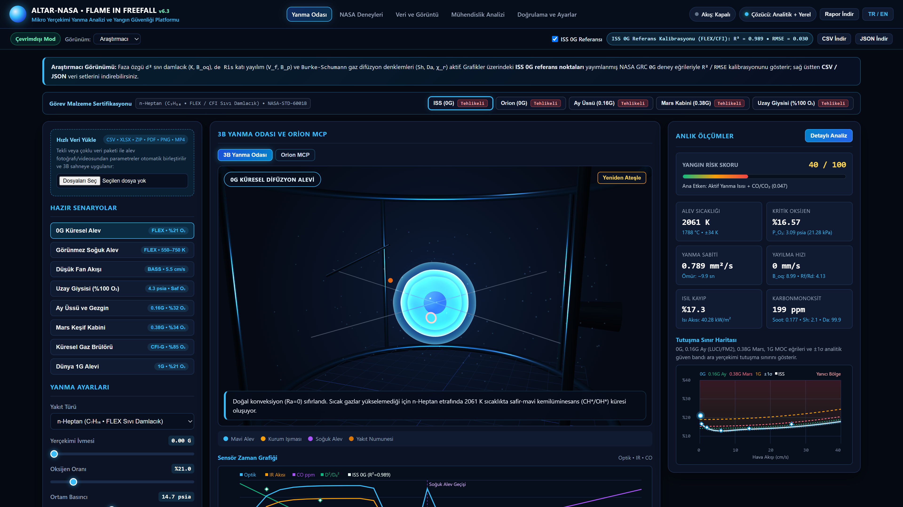

### 2. 0G Küresel Mavi Alev, 1G Dünya Alevi ve Görünmez Soğuk Alev + Seslendirme

Sol paneldeki hazır senaryolar arasında geçiş yaptığınızda veya yerçekimi kaydırıcısını `0.00 G`'den `1.00 G`'ye çektiğinizde, 3 boyutlu yanma odasındaki alev geometrisinin taşınım fiziğine göre nasıl değiştiğini doğrudan gözlemlersiniz. `0G` ortamında yakıt damlacığının çevresinde simetrik safir-mavi bir difüzyon küresi oluşurken, `1G` Dünya koşuluna geçtiğinizde doğal konveksiyon (`Ra`) devreye girer ve kurum ışımasının baskın olduğu yukarı yönlü klasik sarı-turuncu alev formu ortaya çıkar.

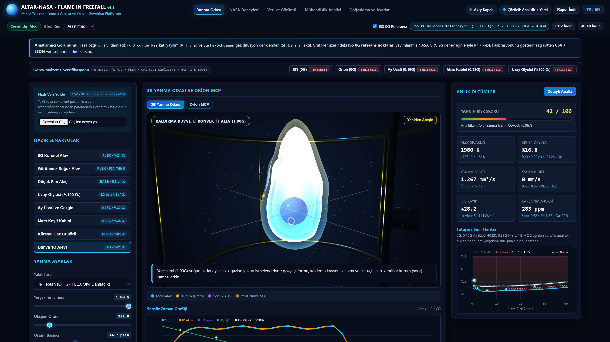

**Görünmez Soğuk Alev** senaryosunu seçtiğinizde ise ışınımsal sönme (`χ_r`) sonrasında `550–750 K` sıcaklığında devam eden soluk morumsu düşük sıcaklık reaksiyonu simüle edilir. Sol alt bölümdeki **Telemetri Seslendirme** (`Sesi Aç`) özelliğini etkinleştirdiğinizde, sıcaklık, ısı akısı ve görünmez soğuk alev salınımları gerçek zamanlı ses frekanslarına ve osiloskop dalga formuna dönüştürülür; böylece mürettebat ekrana bakmadığı anda bile rejim kaymasını işitsel olarak takip edebilir.

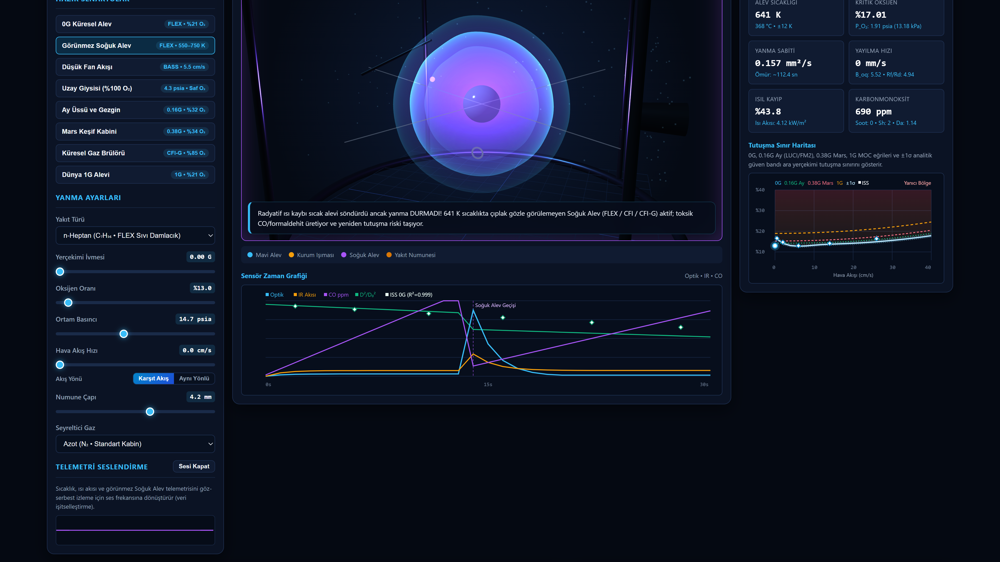

### 3. Özel Malzeme İkizi, Akış Yönü, Tutuşma Sınır Haritası ve Yaşam Destek Saati

Yakıt listesinden `n-Heptan`, `Metanol`, `PMMA`, `Sibal`, `Nomex`, `Propan` veya `Hidrojen` seçebileceğiniz gibi **Özel Malzeme Seçimi** satırına geçip kendi polimer malzemenizi (`PEEK`, `PTFE`, `XLPE`, `Kapton` vb.) yoğunluk (`kg/m³`) ve ısıl iletkenlik (`W/mK`) değerleriyle tanımlayabilirsiniz. Sistem girilen malzemenin termofiziksel ısıl ataletini (`ρ·c_p·λ`) hesaplayarak NASA test arşivindeki en yakın referans malzemeyle eşleştirir. Hava akış yönünü **Karşıt Akış** (`Opposed`) veya **Aynı Yönlü** (`Concurrent`) olarak değiştirdiğinizde sağ paneldeki **Tutuşma Sınır Haritası**, `0G`, `0.16G Ay`, `0.38G Mars` ve `1G Dünya` için minimum oksijen konsantrasyonu (`MOC`) eğrilerini ve `±1σ` belirsizlik bandını 21 akış noktasında yeniden çizer.

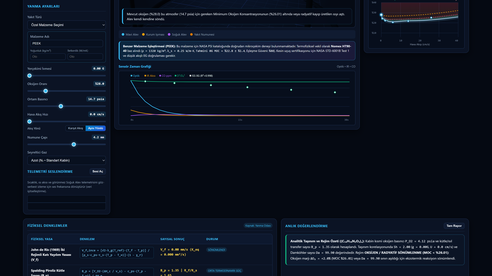

Sayfanın alt bölümüne indiğinizde, o anki kabin koşullarından türetilen **Fiziksel Denklemler** tablosu (`d²` yanma sabiti `K`, `Spalding B_oq`, `de Ris` yayılma hızı `V_f`, `Sherwood Sh`, `Damköhler Da`, ışınımsal kayıp `χ_r`) sayısal sonuçlarıyla listelenir. Hemen altındaki **Yaşam Destek Saati** ise seçtiğiniz kabin hacminde (`ISS Destiny 70 m³`, `Orion / Gateway 19 m³`, `Basınçlı Ay Gezgini 11 m³`, `Mars Kabini 28 m³` veya `EVA Uzay Giysisi 0.18 m³`) karbonmonoksit birikiminin `NASA JSC-20584 SMAC` sınırlarına kaç saniye içinde ulaşacağını hesaplar.

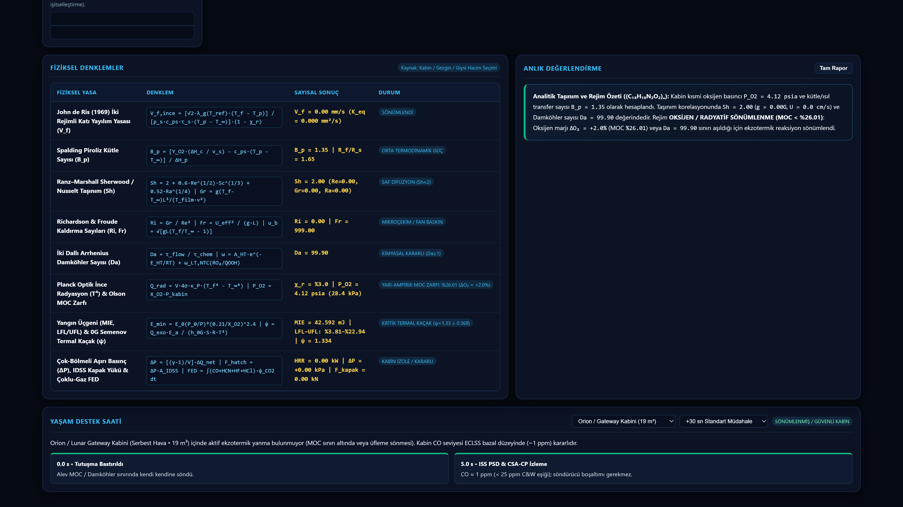

### 4. Orion MCP 3B Uzay Aracı: Dış Gövde ve 5 Bölmeli İç Kesit

Orta panelin üstündeki **Orion MCP** düğmesine tıkladığınızda sahne tekil test odasından çıkarak Artemis mimarisini temel alan 3 boyutlu uzay aracı modeline geçer. **Dış Gövde** görünümünde Orion mürettebat kapsülü, Avrupa Servis Modülü (`ESM`) radyatör panelleri ve güneş kanatları yörünge sahnesinde incelenebilir.

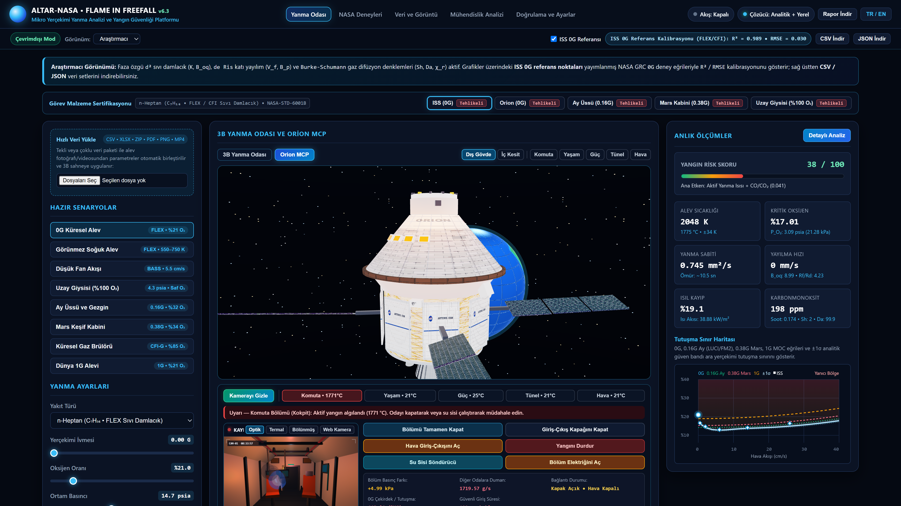

Üst şeritten **İç Kesit** (`Cutaway`) seçeneğine tıkladığınızda gövde kabuğu açılarak birbirine kapaklar ve havalandırma kanallarıyla bağlı beş ayrı bölme (**Komuta**, **Yaşam**, **Güç ve Elektronik**, **Kenetlenme Tüneli**, **Hava Ünitesi**) görünür hale gelir. Üstteki kısayol düğmeleriyle doğrudan istediğiniz bölmeye odaklanabilirsiniz.

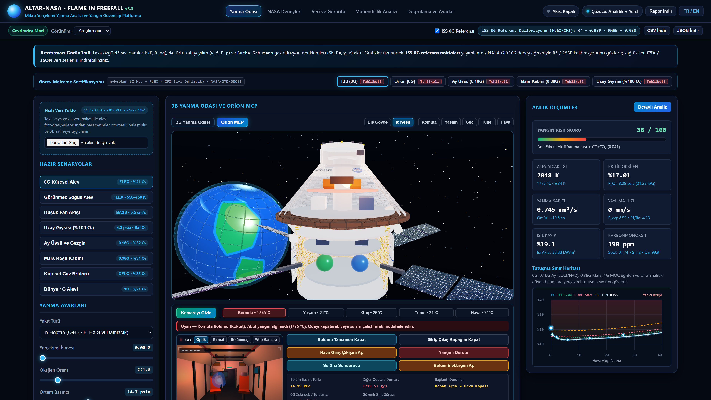

### 5. Canlı 3B Oda Kameraları, 5 Adımlı Sıralı Müdahale ve Havayı Temizleme

Orion MCP konsolunun alt kısmında her bölmenin içini 3 boyutlu perspektifle izleyen canlı güvenlik kamerası yer alır. Kamerayı **Optik**, uzun dalga kızılötesi **Termal (`LWIR Ironbow`)**, her ikisini aynı karede yan yana gösteren **Bölünmüş** (`OPTİK | LWIR IR`) veya bilgisayarınızın gerçek **Web Kamerası** modunda çalıştırabilirsiniz. **Yangın Testi Başlat** düğmesine bastığınızda bölme içindeki sıcaklık ve risk skoru yükselir; **Otonom Koruma Eşiği** (`Risk ≥ 65`) aşıldığı anda geri sayım çubuğu devreye girer ve istenirse **Manuel Devral** ile durdurulabilir.

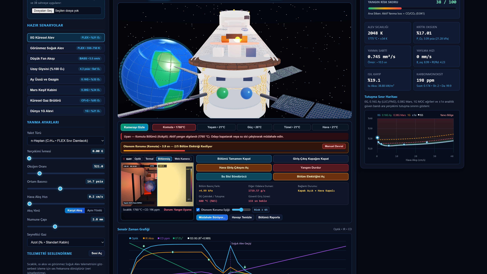

Geri sayım tamamlandığında veya doğrudan **Sıralı Müdahale** düğmesine bastığınızda, uzay aracı yangın protokolü beş ardışık adımda (`1/5 -> 5/5`) uygulanır:
1. **Sensör Teyidi (`1/5`):** Optik, termal (`T_max`) ve `CO` kanallarından yangın konumu doğrulanır.
2. **Havalandırma Kesme (`2/5`):** Bölmeler arası `IMV` fan akışı durdurularak oksijen beslemesi ve duman taşınımı kesilir.
3. **Güç İzolasyonu ve Kapak Kapatma (`3/5`):** `120 VDC SSPC` hatları enerjisiz bırakılır ve bölme kapağı kilitlenir.
4. **Temiz Su Sisi Söndürücü (`4/5`):** İnsanlı kapalı kabinlerde `Halon 1301` gazı alevde parçalanarak zehirli ve aşındırıcı `HF / HBr` asit gazları ürettiği için `NASA-STD-6001B` kapsamında kesin olarak yasaktır; bunun yerine `SoFIE-MIST` mimarisine uygun `<40 µm` ince su sisi uygulanır.
5. **Atmosferik Kararlılık ve Soğutma (`5/5`):** Alev bastırıldıktan sonra kor yüzeyin `525 K` altına inmesi takip edilir.

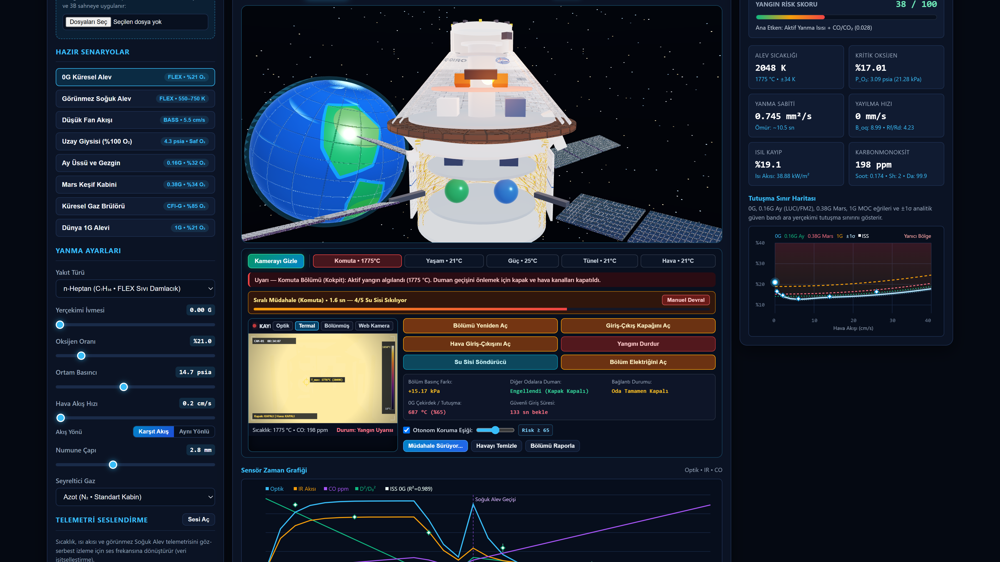

Müdahale tamamlandıktan sonra **Havayı Temizle** (`CAMRAS`) kontrolüyle bölmedeki karbonmonoksit ve yanma aerosolleri süzülür. Konsol üzerindeki özet kutusundan bölme basınç farkını (`ΔP`), komşu odalara duman geçiş hızını (`g/s`), yeniden tutuşma riskini ve kapağı güvenle açmak için gereken soğuma süresini saniye saniye izleyebilirsiniz.

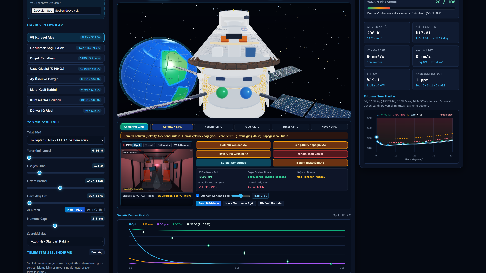

### 6. Sekme 2 — NASA PSI Deney Sıralaması, Karşılaştırma ve Dünya Uygulamaları

**NASA Deneyleri** sekmesi, o an 3 boyutlu yanma odasında ayarladığınız yerçekimi, oksijen, basınç ve akış koşullarına fiziksel olarak en yakın `15+` doğrulanmış NASA `PSI` araştırmasını (`FLEX`, `FLEX-2`, `BASS`, `BASS-II`, `Saffire I–VI`, `SoFIE`, `ACME CFI-G`, `E-FIELD`, `SPICE`, `SLICE`, `SAME`, `DAFT`) uyum skoruna göre sıralar. Üstteki donanım filtreleriyle (`ISS CIR / ACME`, `MSG Fan Kanalı`, `Cygnus Aracı`, `Duman ve Toz`) deneyleri kullanılan uçuş donanımına göre daraltabilirsiniz.

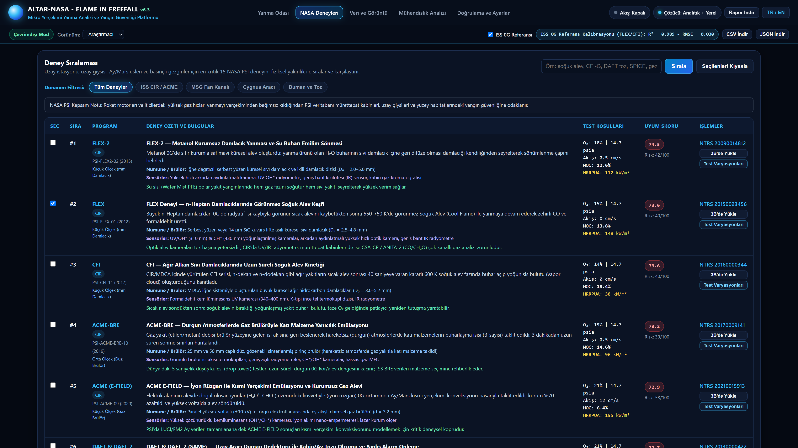

Tablodaki herhangi bir araştırmanın **Test Varyasyonları** düğmesine tıkladığınızda aynı deney düzeneği içindeki farklı oksijen ve akış koşullarını tek tıkla 3 boyutlu odaya yükleyebilirsiniz. Alt bölümdeki **Deney Karşılaştırması** seçili araştırmaları yan yana getirerek `0G` ve `1G` sınırlarını özetler; **Dünya Uygulamaları** bölümü ise yörüngedeki yanma deneylerinden doğan teknolojilerin yeryüzündeki itfaiyeci koruyucu giysilerine, solunum tüplerine, çok kanallı duman dedektörlerine ve düşük emisyonlu motor tasarımına nasıl aktarıldığını açıklar.

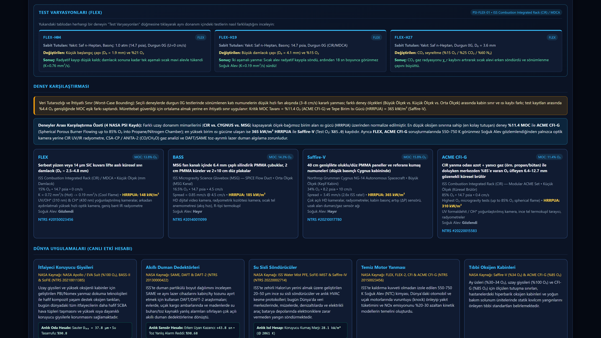

### 7. Sekme 3 — Canlı NASA Akışı, Görüntü İşleme (CV) ve Özel Denklem Doğrulama (AST)

**Veri ve Görüntü** sekmesi, dış deney verilerini doğrudan simülasyonla birleştirmek için tasarlanmıştır. Üst bölümdeki **Canlı NASA Akışı** ve sol sütundaki **NASA Arşiv Sorgusu** üzerinden resmi `psi.nasa.gov`, `ntrs.nasa.gov` ve `osdr.nasa.gov` kayıtlarında gerçek zamanlı arama yapabilir veya bir araştırma bağlantısını **Web Bağlantısı Çözümle** kutusuna yapıştırarak deney parametrelerini 3 boyutlu odaya çekebilirsiniz.

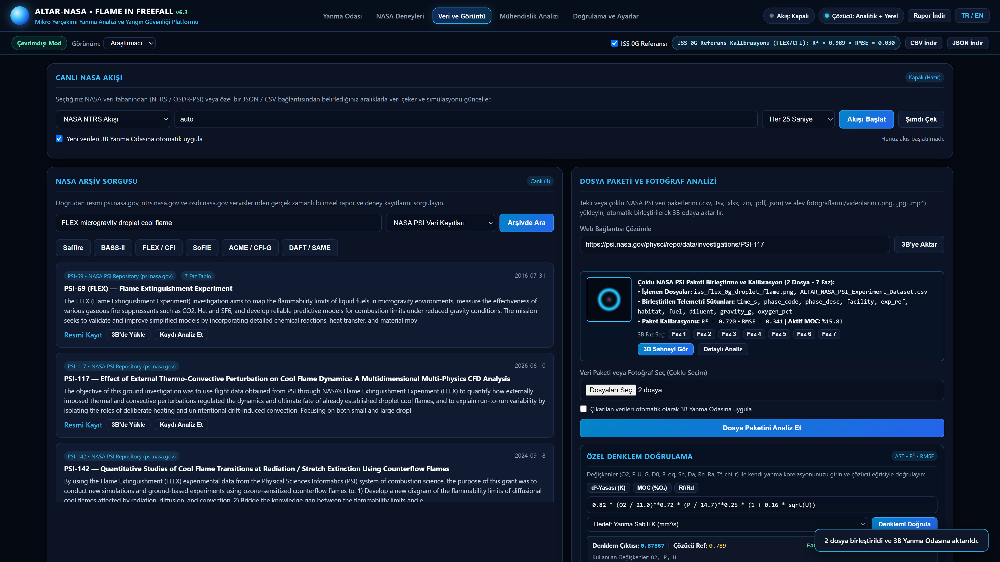

Sağ sütunda kendi deney tablolarınızı (`.csv`, `.tsv`, `.xlsx`, `.zip`, `.json`, `.pdf`) ve alev fotoğraflarınızı veya videolarınızı (`.png`, `.jpg`, `.gif`, `.mp4`) tekli ya da çoklu paket halinde yükleyebilirsiniz. Görüntü işleme modülü alevin küresellik oranını, mavi kemilüminesans / sarı kurum parlaklık dağılımını ve `Rf/Rd` sınır oranını çıkarırken tablo verileriyle otomatik kalibrasyon yapar. Hemen altındaki **Özel Denklem Doğrulama** (`AST`) aracına kendi matematiksel korelasyonunuzu (`O2, P, U, G, D0, B_oq, Sh, Da, Re, Ra, Tf, chi_r` değişkenleriyle) yazıp `eval()` kullanmayan güvenli sözdizimi ağacı üzerinden çözücü eğrisine karşı `R²` ve `RMSE` doğruluğunu sınayabilirsiniz.

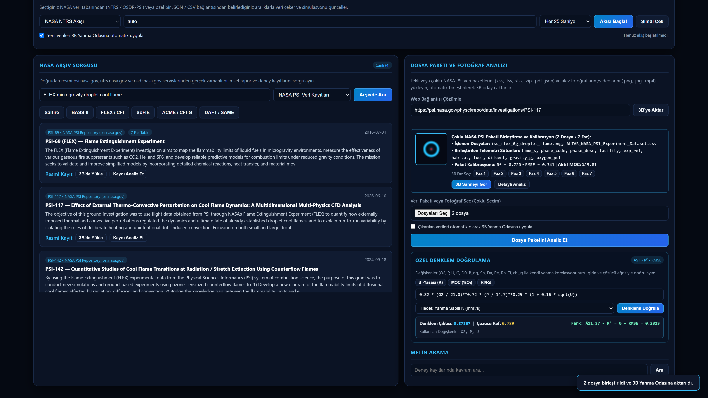

### 8. Sekme 4 — Mühendislik Analizi, Fiziksel Yanılgı Denetimi ve Etkileşimli Eylemler

**Mühendislik Analizi** sekmesi, aktif 3 boyutlu yanma odası telemetrisini ve `15` NASA PSI deneyini soru odaklı olarak değerlendirir. Üst çubuktan **Analitik Fizik Çözücü** (hiçbir dil modeline veya internete ihtiyaç duymadan çalışan deterministik motor), **Çevrimdışı Yerel Model (`Ollama`)**, **Yerel Sistem Köprüsü** veya isteğe bağlı bulut geçitleri arasında seçim yapabilirsiniz.

Sorgu denetleyicisi yalnızca uzay aracı yangın güvenliği ve yanma fiziği kapsamındaki soruları yanıtlar; çok anlamlı günlük ifadeleri (`kısık ateşte yemek`, `ateş düşürücü` vb.) kibarca kapsam dışı tutarken, sık karşılaşılan fiziksel yanılgıları (örneğin *"0G istasyonda tavanda biriken duman için sensör nereye takılır?"*, *"Vakumda ateş yanar mı?"*, *"0G kabinde yangına kova ile su dökülür mü?"* veya *"Yangın söner sönmez soğumadan kapağı açalım mı?"*) otomatik tespit ederek yanıtın başında **Fiziksel Düzeltme** rozetiyle doğrusunu açıklar. Üretilen mühendislik analizinin altındaki **3B Odaya Uygula** ve **Sıralı Müdahaleyi Başlat** düğmeleriyle önerilen senaryoyu tek tıkla 3 boyutlu sahnede çalıştırabilir; üst bardaki **Rapor İndir** düğmesiyle tüm SVG grafikleri ve tabloları içeren görsel raporu (`.HTML / PDF`) kaydedebilirsiniz.

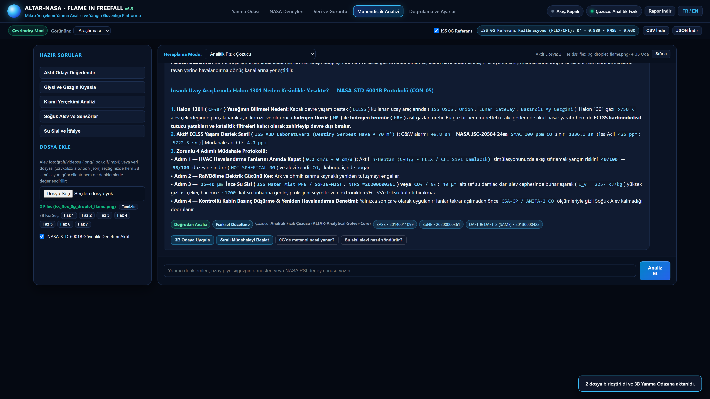

### 9. Sekme 5 — Zorunlu Fiziksel Kurallar ve %100 Çevrimdışı Yerel Model Mimarisi

**Doğrulama ve Ayarlar** sekmesinde, tüm hesaplama adımlarında zorunlu olarak denetlenen fiziksel yasalar ve `NASA-STD-6001B` güvenlik kuralları açıkça listelenir. Alt panellerden aktif çözücünün tepki süresini test edebilir, yerel `Ollama` (`http://127.0.0.1:11434`) modelinizi yönetebilir ve isteğe bağlı harici API anahtarlarını kaynak koda hiç dokunmadan yalnızca kendi bilgisayarınızdaki kullanıcı yapılandırmasında saklayabilirsiniz.

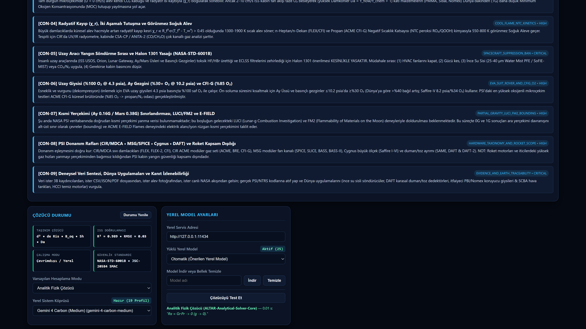

---

## Arka Plandaki Fiziksel Modeller ve Güvenlik Standartları

Platformda yer alan tüm grafikler ve telemetri kartları rastgele animasyonlara değil, doğrudan yanma ve taşınım denklemlerine dayanır:

| Fiziksel Model / Standart | Matematiksel İfade ve Rolü | Uzay Aracı Güvenliğindeki Karşılığı |
| :--- | :--- | :--- |
| **Godsave–Spalding `d²` Yasası** | $d^2(t) = d_0^2 - K \cdot t$, $K = \frac{8 \rho_g D_{im}}{\rho_l} \ln(1 + B_{oq})$ | `0G` ortamında küresel sıvı yakıt damlacıklarının çap küçülme hızını ve toplam yanma ömrünü belirler (`ISS FLEX`). |
| **Spalding Kütle Aktarım Sayısı (`B_oq`)** | $B_{oq} = \frac{Y_{O_2,\infty} \Delta H_c / \nu_s - c_p (T_s - T_\infty)}{L_v}$ | Buharlaşma gizli ısısına karşı yanma entalpisinin sürüklediği kütle aktarım potansiyelini ve `Rf/Rd` alev mesafesini tanımlar. |
| **de Ris Katı Yüzey Yayılımı (`V_f`)** | İnce ve kalın katı polimerler için karşıt/aynı yönlü akış ısıl dengesi | `PMMA`, `Sibal`, `Nomex` ve özel polimerlerin (`PEEK`, `PTFE`) düşük fan akışındaki yüzey alev yayılma hızını hesaplar (`BASS`, `Saffire`). |
| **Burke–Schumann Gaz Difüzyonu** | Sabit brülör debisinde difüzyon alev yarıçapı ve stokiyometrik sınır | Gaz yakıtlı küresel brülör deneylerinde (`ACME CFI-G`, `SLICE`) kararlı alev cephesini modeller. |
| **Boyutsuz Taşınım Sayıları (`Gr, Ra, Ri, Sh`)** | $Sh = 2 + 0.6 Re^{1/2} Sc^{1/3}$, $Ra = Gr \cdot Pr$ | `0G`, `0.16G Ay`, `0.38G Mars` ve `1G Dünya` arasındaki doğal kaldırma ile zorlanmış fan akışı dengesini kurar. |
| **Damköhler (`Da`) ve Işınımsal Kayıp (`χ_r`)** | Kimyasal hız / akış hızı oranı ve ışınımsal sönme kesri | Düşük gerinim hızlarında yüksek sıcaklık alevinin sönüp `550–750 K` görünmez soğuk aleve geçiş sınırını belirler. |
| **`NASA-STD-6001B` ve `JSC-20584 SMAC`** | Yukarı yönlü alev yayılım testi (`Test 1`), `MOC` ve `CO` maruziyet limitleri | Beş görev fazında malzeme kabul/ret kararını, `Halon 1301` yasağını ve mürettebat tahliye/müdahale süresini belirler. |

---

## Proje Klasör Yapısı ve Güvenlik Mimarisi

```text
Nasa-Türkçe/
├── main_nasa.py                  # Yerel 127.0.0.1 Flask sunucusu, API uçları ve --self-test doğrulayıcısı
├── build_serverless_web.py       # Sunucusuz statik web paketini (web_serverless/) üreten derleyici
├── nasa_icon.py                  # Masaüstü uygulaması için çok çözünürlüklü ikon üreticisi
├── Nasa_4.spec                   # Tek dosya bağımsız Windows .exe (PyInstaller) yapılandırması
├── Nasa_Hemen_Calistir.bat       # Python/Git yüklü olmayan bilgisayarlar için tek tıkla başlatıcı
├── Nasa_EXE_Olustur.bat          # Kaynak koddan bağımsız Nasa_4.exe derleme başlatıcısı
├── requirements.txt              # Doğrulanmış Python bağımlılıkları (Flask, numpy, PyMuPDF, Pillow, certifi)
├── LICENSE                       # Resmi Apache License 2.0 tam metni
├── NOTICE                        # Telif ve açık bilim veri kaynağı bildirimleri
├── core/
│   ├── physics_engine.py         # d², de Ris, Burke-Schumann, MOC (±1σ), 5 fazlı sertifikasyon ve AST çözücü
│   ├── ignition_kinetics.py      # Tutuşma gecikmesi, NTC soğuk alev kinetiği ve yeniden tutuşma modeli
│   ├── compartment_network.py    # 5 bölmeli Orion MCP basınç, kapak ve duman taşınım ağı
│   ├── fdir_hardware_bus.py      # IMV fan, SSPC 120 VDC, kapak kilidi, su sisi ve CAMRAS durum makinesi
│   ├── data_vision_processor.py  # Çoklu CSV/XLSX/ZIP/PDF ayrıştırıcı ve alev görüntü işleme (CV) motoru
│   ├── nasa_datasets.py          # Doğrulanmış 15+ NASA PSI deney kataloğu ve malzeme veritabanı
│   ├── nasa_live_fetcher.py      # Resmi psi.nasa.gov / ntrs.nasa.gov / osdr.nasa.gov canlı sorgu istemcisi
│   ├── ranking_engine.py         # Fiziksel yakınlık tabanlı PSI sıralama ve deney karşılaştırma motoru
│   ├── scope_guard.py            # Çift dilli konu kapsamı, çok anlamlılık kilidi ve fiziksel yanılgı denetçisi
│   ├── smart_synthesizer.py      # Çevrimdışı analitik mühendislik raporu sentezleyicisi
│   ├── ai_engine.py              # Analitik çözücü, yerel Ollama ve isteğe bağlı geçit yöneticisi
│   ├── directives.py             # Zorunlu fiziksel kurallar ve NASA-STD-6001B güvenlik kısıtları
│   ├── config_manager.py         # Yerel kullanıcı yapılandırması (%APPDATA%\AltarNasa veya .runtime/userdata)
│   └── security_guard.py         # 127.0.0.1 loopback kilidi, CSRF doğrulaması ve SSRF alan adı koruması
├── web/
│   ├── templates/index.html      # Ana görev kontrol arayüz şablonu (TR varsayılan, anlık TR/EN destekli)
│   └── static/                   # CSS, Three.js, 3B yanma odası, 3B Orion MCP, grafik/ses ve kontrolcü betikleri
├── web_serverless/               # GitHub Pages üzerinde çalışan %100 sunucusuz statik tarayıcı paketi
├── sample_data/                  # Örnek NASA PSI damlacık ve katı yayılım CSV veri setleri
├── scripts/
│   ├── bootstrap_nasa.ps1        # Kayıt defterine dokunmayan taşınabilir Python 3.12.8 + Ollama kurulum betiği
│   └── Modelfile.nasa-portable   # Yerel çevrimdışı bilim modeli sistem profili
└── docs/screenshots/             # Uygulamadan alınmış gerçek 1920x1080 (@2x) Türkçe arayüz ekran görüntüleri
```

**Sıfır-Güven ve İzolasyon İlkeleri:**
- **Yalnızca Yerel Arayüz (`127.0.0.1`):** Masaüstü/Python sürümü dış ağ arayüzlerine (`0.0.0.0`) port açmaz; tüm durum değiştiren istekler oturuma özel `CSRF` anahtarıyla korunur.
- **Güvenli Denklem ve Dosya İşleme:** Özel denklem doğrulayıcı Python `eval()` fonksiyonunu kesinlikle kullanmaz; yalnızca beyaz listedeki matematiksel düğümlere izin veren soyut sözdizimi ağacı (`AST`) üzerinde çalışır.
- **Sunucusuz Statik Paket (`web_serverless/`):** GitHub Pages üzerinde çalışan sürüm hiçbir arka plan sunucusu içermez; katı `Content-Security-Policy (CSP)` kurallarıyla tüm simülasyonu ve dosya analizini doğrudan tarayıcı belleğinde yürütür.

---

## Çalıştırma Rehberi (Bilgisayarında Hiçbir Şey Yüklü Olmayanlar ve Geliştiriciler İçin 4 Yöntem)

Projeyi incelemek için bilgisayarınızda Python, Git veya herhangi bir yazılım geliştirme aracının kurulu olması gerekmez. Size en uygun yöntemi seçebilirsiniz:

### Yöntem 1 — Hiçbir Dosya İndirmeden Doğrudan Tarayıcıda Açma (0 Kurulum, Tüm Cihazlar)

Bilgisayar, tablet veya telefonunuzdan doğrudan canlı web bağlantısına tıklayın:

- **Canlı Web Adresi:** https://faruk042.github.io/Nasa-Turkce/

İndirdiğiniz proje klasörünün içindeki `web_serverless/index.html` dosyasına çift tıklayarak da aynı sunucusuz sürümü çevrimdışı olarak tarayıcınızda açabilirsiniz. 3B Yanma Odası, 3B Orion MCP uzay aracı, 5 adımlı yangın müdahalesi ve analitik fizik çözücü anında çalışır.

### Yöntem 2 — Tek Tıkla Çalışan Hazır Windows `.exe` İndirme (Kurulumsuz Masaüstü Sürümü)

Python veya komut satırıyla hiç uğraşmadan tam masaüstü sürümünü (yerel sunucu, canlı NASA PSI/NTRS arşiv köprüsü ve yerel model desteği dahil) çalıştırmak için:

1. **[GitHub Releases (`v6.3`)](https://github.com/Faruk042/Nasa-Turkce/releases/latest)** sayfasından **`Nasa_4.exe`** dosyasını indirin.
2. İndirdiğiniz `Nasa_4.exe` dosyasına çift tıklayın.
   *(Not: Bağımsız açık kaynak derlemesi olduğu için ilk açılışta Windows SmartScreen bilgi penceresi görünürse **Ek bilgi -> Yine de çalıştır** seçeneğine tıklamanız yeterlidir.)*

### Yöntem 3 — `Download ZIP` + Otomatik Kurulum Başlatıcısı (Bilgisayarda Python Yüklü Olmasa Bile)

Kaynağı ZIP olarak indirip tek tıkla çalıştırmak veya kendi `.exe` dosyanızı üretmek isterseniz:

1. Bu sayfanın sağ üstündeki yeşil **`Code -> Download ZIP`** düğmesine tıklayıp arşivi bilgisayarınızda bir klasöre çıkarın.
2. Klasörün içindeki **`Nasa_Hemen_Calistir.bat`** dosyasına çift tıklayın.
   - Betik, Windows Kayıt Defteri'ne (`Registry`) veya sistem `PATH` ayarlarınıza dokunmadan; bilgisayarınızda Python kurulu değilse resmi taşınabilir **Python 3.12.8** paketini, gerekli bilimsel kütüphaneleri ve isteğe bağlı taşınabilir yerel modeli yalnızca klasörün içindeki izole `.runtime/` dizinine kendi kendine kurar ve uygulamayı başlatır.
   - Bilgisayarda internet bağlantısı hiç yoksa otomatik olarak `web_serverless/index.html` çevrimdışı tarayıcı sürümünü açar.
   - Kaynak koddan kendi bağımsız `Nasa_4.exe` dosyanızı derlemek isterseniz **`Nasa_EXE_Olustur.bat`** dosyasına çift tıklamanız yeterlidir.

### Yöntem 4 — Geliştiriciler İçin Manuel Python / Git Kurulumu (Windows / macOS / Linux)

```bash
git clone https://github.com/Faruk042/Nasa-Turkce.git
cd Nasa-Turkce

# Sanal ortam oluşturma ve bağımlılıkları yükleme
python -m venv .venv
# Windows:
.venv\Scripts\activate
# macOS / Linux:
# source .venv/bin/activate

pip install -r requirements.txt

# Öz-doğrulama test paketini çalıştırma (0 hata ile tamamlanmalıdır)
python main_nasa.py --self-test

# Uygulamayı başlatma (127.0.0.1 üzerinde açılır)
python main_nasa.py
```

İsteğe bağlı olarak tamamen çevrimdışı yerel dil modeli desteği için [Ollama](https://ollama.com) kuruluysa `ollama pull qwen3.5:4b` komutunu çalıştırmanız yeterlidir; uygulama yerel servisi otomatik algılar.

---

## Lisans

Bu proje açık kaynaklı olarak **[Apache License 2.0](LICENSE)** kapsamında lisanslanmıştır. Telif bildirimleri ve açık bilim veri kaynağı atıfları için **[NOTICE](NOTICE)** dosyasına bakabilirsiniz.
